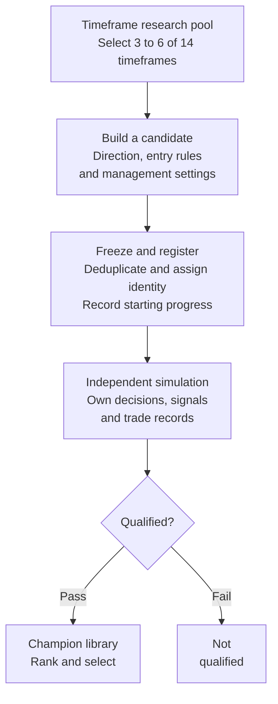
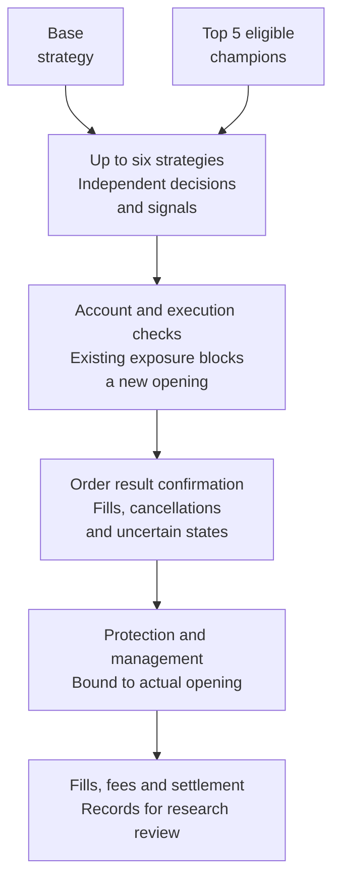

# CP210 · Trading Research and Execution Project

English · [简体中文](README.md)

CP210 is a trading research and execution project under active development and validation. It connects multi-timeframe composition, candidate generation, independent simulation, qualification, and live execution. We are looking for partners who understand trading, think independently, and want to develop ideas and verify results together.

**This repository is a project showcase. Its code example and fixture data were written specifically for a synthetic demonstration. They do not contain production strategies or represent live trading or backtest results.**

## Core process: how a candidate reaches live trading

The design addresses three questions: where candidates come from, whether their simulated records support promotion, and how independent strategies coordinate execution on one account. These are concrete design choices within this project; we do not claim industry-first methods.

### Stage one: from the timeframe pool to the champion library



**Each candidate has a fixed identity and configuration.** Its timeframes, direction calculations, entry rules, and management settings are established at generation. Processing starts from the registered event position using then-available evidence. Persisted progress helps trace a result to its rules and inputs.

**Market inputs can be shared while strategy state remains independent.** Simulated strategies maintain their own direction calculations, signals, and trading records. Simulation concurrency is adjusted according to resources, latency, and operating health.

**Rule changes and data-task retries are treated separately.** A variant is evaluated under its new configuration without inheriting its parent's qualification result. Retrying the same data task retains strategy identity to reduce duplicate accounting.

**Promotion requires trading evidence.** Review includes valid samples, profit criteria, and coverage of both long and short trades. Passing candidates enter the champion library. Exact sample thresholds, calculations, and ranking rules remain private.

### Stage two: from champion selection to position closure



**Champion ranking establishes eligibility; the base strategy still participates independently.** With enough eligible champions, the base strategy and the top five champions provide up to six contenders. Each owns its decisions and signals; another strategy's direction change does not directly invalidate its signal.

**An opportunity must pass account and execution checks before submission.** Parallel calculations do not give each strategy a separate position. Shared constraints cover account exposure, pending requests, and execution state.

**Management responsibility remains attached to an existing position.** Changes in strategy selection do not remove the corresponding protection obligation. Actual fills and account bills are reconciled, and records support later research review.

The process is public at the level of responsibilities and component relationships. Decision formulas, parameter ranges, qualification thresholds, ranking, and exit rules remain private.

## Scale and engineering features

- **6,370 timeframe combinations:** with all 14 configured timeframes available, each candidate selects 3 to 6 distinct direction timeframes. This gives `C(14,3) + C(14,4) + C(14,5) + C(14,6) = 6,370`. Generation uses timeframes with available technical data.
- **Configurable candidates and structural deduplication:** calculation rules, entry settings, and position-management settings extend the research space. Structural signatures help identify duplicate candidates.
- **Simulated evaluation before promotion:** candidates are evaluated before admission to the champion library. Qualification is not a guarantee of future profitability.
- **Up to six strategies competing for entries:** when enough champions are eligible, the base strategy and the top five champions participate. Shared account constraints still apply; this does not mean six simultaneous positions.
- **Independent strategy state:** strategies maintain their own decisions and signals, while order submission remains subject to account-level controls.
- **Adjustable simulation concurrency and persistent records:** operating health and latency inform concurrency adjustments. Persisted identities, processing cursors, and key events support investigation and recovery.

Configuration counts do not measure completed experiments, economically distinct behavior, or profitable strategies. The project remains in development and validation; it does not currently present public evidence establishing consistent profitability.

## Questions we would like to research together

- How should timeframe composition, direction assessment, and entry timing fit different market conditions?
- Do qualification samples cover enough conditions, and how can configurations suited to only one market phase be identified?
- How much do simulation-to-live execution differences, costs, and signal invalidation each affect results?
- How can incident diagnosis, recovery, and reproducibility of research records be improved?

## Who we would like to work with

We welcome people with practical knowledge of trading and risk who can challenge assumptions and evaluate ideas using reproducible evidence. Relevant experience may include strategy research, software development, data analysis, testing, or risk management.

Initial work can focus on a clearly defined task, such as market-data quality, an entry rule, cost attribution, or verification of experimental results. We would first establish how we work together and discuss contributions, time commitments, shared infrastructure costs, ownership of results, and exit arrangements.

This is an early-stage collaboration invitation. Necessary research materials and code access would be scoped to the agreed work.

## Run the synthetic example

Python 3.10 or newer is required. The example uses only the standard library:

```sh
python demo.py
```

It reads the fixed fixture in `examples/synthetic-scenario.json` and prints a sequence of virtual account events. It has no network client, exchange connection, real order sender, strategy generator, or profitability calculation. This example illustrates account gating and audit events only.

## Contact

Collaboration email: [zb1882014@outlook.com](mailto:zb1882014@outlook.com)

Please briefly introduce your trading background, relevant skills, time availability, and the area you would like to work on. Messages in English or Chinese are welcome.

Production strategy code, learning state, live configuration, account records, and deployment materials remain private. No open-source license has been selected for the showcase code; see [NOTICE](NOTICE.md).
