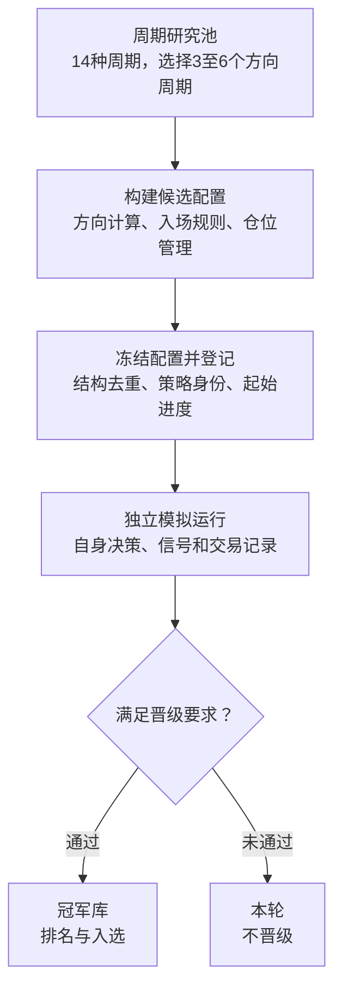
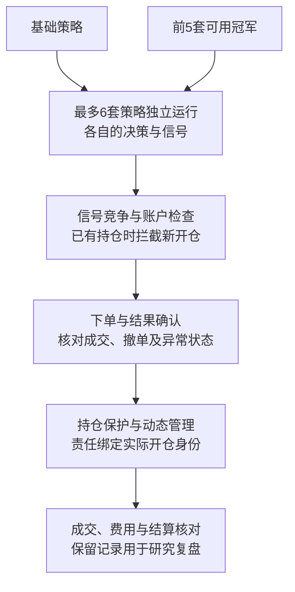

# CP210 · 交易研究与执行系统展示

[English](README.en.md) · 简体中文

CP210是一个持续开发和验证中的交易研究与执行项目，把多周期组合、候选生成、独立模拟、评估晋级和实盘执行衔接起来。希望找到理解交易、有独立判断、愿意共同研究和核验结果的合伙人。

**本仓库用于项目展示。示例程序和所有示例数据均为专门编写的虚拟演示，不包含生产策略，也不代表实盘收益或回放结果。**

## 核心流程：一套候选策略怎样走到实盘

系统围绕三个问题组织：候选策略从哪里来，模拟结果能否支持晋级，以及多个策略如何在同一账户下独立研究、协调执行。下面展示本项目的具体设计过程，不作行业首创声明。

### 第一段：从周期池到冠军库



**候选策略有固定身份和配置。** 周期、方向计算、入场与管理设置在生成时确定并记录。候选依据当时可用的数据开始运行，保存各自的处理进度，便于追溯一个结果对应的规则与证据。

**共享市场输入，各自维护策略状态。** 模拟策略分别计算方向、产生信号并积累交易记录；模拟并行规模根据资源、延迟及运行状态调节。

**变更规则与重试数据任务分开处理。** 规则变体按新配置重新评估，不继承父策略的合格成绩；同一数据任务重试时保留策略身份，减少重复统计。

**晋级需要交易记录支持。** 评估包含有效样本、盈利条件和多空成交覆盖要求，通过后进入冠军库。具体样本门槛、计算方法与排名细则保留在私有实现中。

### 第二段：从冠军入选到持仓结束



**冠军排名决定参与资格，基础策略仍独立参与。** 冠军数量及可用状态满足时，基础策略与前5套冠军最多形成6套开仓竞争者。各策略维护自身的决策和信号，其他策略的方向变化不直接决定它的信号失效。

**策略机会经过账户和执行检查后才能发单。** 计算与信号并行，并不意味着各策略分别占有仓位；同账户仍受统一持仓、待处理请求与执行状态约束。

**开仓后的管理责任持续绑定持仓。** 策略的入选资格发生变化时，已有持仓对应的保护责任仍需保留。执行结果以成交回执与实际账单核对，记录供后续研究复盘。

上述过程公开组件职责与协作关系。实际决策公式、参数范围、晋级阈值、排名和退出细则继续保留私有。

## 规模与设计特点

- **6,370种周期组合**：完整14周期池，每套选择3～6个不同方向周期；实际使用以数据就绪为前提。
- **参数化生成与结构去重**：在周期组合上配置计算、入场和管理规则，减少重复候选。
- **模拟评估后晋级**：候选经过模拟和合格评估，符合要求后进入冠军库。
- **最多6套实盘机会竞争**：基础策略加前5套可用冠军策略，账户层仍统一约束实际下单。
- **各策略独立状态、关键记录持久化**：支持分别管理信号、追踪处理过程和接续处理。

以上是配置空间和设计能力，不能当作已经测试或已经盈利的策略数量。详见 [规模计算与设计特点](docs/highlights.md)。

## 目前希望共同研究的问题

- 周期组合、方向判断与入场时机，怎样匹配不同市场状态？
- 策略的合格样本覆盖是否充分，如何识别只适合某段行情的配置？
- 模拟与实盘的成交差异、费用和信号失效，分别影响了多少结果？
- 如何提升异常定位、运行恢复及研究记录的可复核性？

项目仍处于开发验证阶段，目前没有公开足以证明稳定盈利的结果。

## 仓库内容

| 内容 | 用途 |
| --- | --- |
| [规模与设计特点](docs/highlights.md) | 核对周期组合数量，了解候选生成、晋级与执行约束 |
| [架构说明](docs/architecture.md) | 逐项了解周期池到并行交易的职责和公开边界 |
| [协作方式](docs/collaboration.md) | 了解可参与的研究问题和验证要求 |
| [展示范围](docs/public-scope.md) | 区分演示内容和未公开部分 |
| [演示程序](demo.py) | 查看信号输入、账户约束和审计事件如何分工 |
| [虚拟场景](examples/synthetic-scenario.json) | 运行一组固定的虚拟事件 |

## 本地运行

需要 Python 3.10 或更高版本，仅使用标准库，无须账户或交易凭据。

```sh
python demo.py
```

程序读取仓库内的固定虚拟场景，将结果打印到终端。它没有网络请求、交易所连接或真实下单实现。

演示流程：

1. 一个虚拟信号被模拟账户接受。
2. 另一个虚拟信号遇到已有持仓，受到模拟账户约束。
3. 场景提供一条虚拟平仓事件。
4. 一个新的虚拟信号被接受。

这是上述流程中“账户约束与事件记录”这一小段的组件演示，不是完整策略生成器、模拟评估器或历史回放，不计算胜率或收益，也不复现生产信号的生命周期。

## 寻找怎样的合伙人

希望你理解交易步骤与风险，能够提出不同意见，愿意一起研究策略、复核数据和改进程序。交易研究、开发或测试经验都可以成为合作的起点。

目前先从一个具体研究问题开始合作，了解彼此的能力、投入和工作方式。分工、基础费用、成果归属及退出方式，再根据实际合作约定。

## 联系方式

合作邮箱：[zb1882014@outlook.com](mailto:zb1882014@outlook.com)

欢迎用中文或英文来信，简要介绍你的交易经历、擅长方向、可投入的时间及希望参与的工作。

生产策略实现、学习状态、实际配置、账户数据与部署环境不在本仓库内。示例代码的发布许可尚未选定，参见 [NOTICE](NOTICE.md)。
