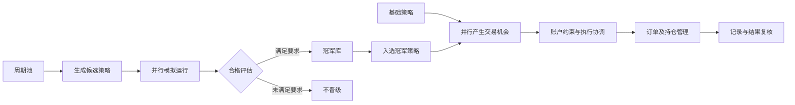

# CP210 · 交易研究与执行系统展示

这是一个持续开发中的交易研究与执行项目。希望找到理解交易、有独立判断、愿意共同研发和验证策略的合伙人。本仓库介绍系统流程，并展示一小部分专门编写的示例。

**当前仓库是展示草稿。示例程序和所有示例数据均为专门编写的虚拟演示，不包含生产策略，也不代表实盘收益或回放结果。**

## 核心流程

项目以“候选策略经过模拟与筛选，再参与账户交易竞争”的流程组织研究和执行：



周期池为候选策略提供研究范围；生成的策略先进入模拟评估，满足条件后进入冠军库。基础策略与入选冠军策略独立产生机会，账户层协调实际下单。同账户的持仓约束仍然有效，“并行”不代表所有策略可以各自同时持仓。

公开流程便于理解系统如何组织。实际的周期选择、生成算法、合格标准、排名依据、信号规则与持仓管理实现未包含在此仓库中。这类总体流程可以借鉴，本项目的定制工作在具体规则、组件衔接和可核验的实现上，不据此宣称行业独创或盈利优势。

## 规模与设计特点

- **6,370种周期组合**：完整14周期池，每套选择3～6个不同方向周期；实际使用以数据就绪为前提。
- **参数化生成与结构去重**：在周期组合上配置计算、入场和管理规则，减少重复候选。
- **模拟评估后晋级**：候选经过模拟和合格评估，符合要求后进入冠军库。
- **最多6套实盘机会竞争**：基础策略加前5套可用冠军策略，账户层仍统一约束实际下单。
- **各策略独立状态、关键记录持久化**：支持分别管理信号、追踪处理过程和接续处理。

以上是配置空间和设计能力，不能当作已经测试或已经盈利的策略数量。详见 [规模计算与设计特点](docs/highlights.md)。

## 工程关注的问题

- 将行情输入、策略研究、执行权限与结果核对分开管理。
- 支持多策略产生机会，同时在账户层协调开仓。
- 追踪信号、订单、持仓和结算之间的对应关系。
- 在异常和重启后保留必要状态，让运行情况可以复核。
- 研究入场条件和持仓管理的改善方法，检验其是否适用于不同市场状态。

这些是开发方向和系统能力说明，不是对长期盈利能力的承诺。目前不提供足以证明稳定盈利的公开结果。

## 仓库内容

| 内容 | 用途 |
| --- | --- |
| [规模与设计特点](docs/highlights.md) | 核对周期组合数量，了解候选生成、晋级与执行约束 |
| [架构说明](docs/architecture.md) | 逐项了解周期池到并行交易的职责和公开边界 |
| [协作方式](docs/collaboration.md) | 了解可参与的研究问题和验证要求 |
| [展示范围](docs/public-scope.md) | 区分演示内容和未公开部分 |
| [演示程序](demo.py) | 查看信号输入、账户约束和审计事件如何分工 |
| [虚拟场景](examples/synthetic-scenario.json) | 运行一组固定的虚拟事件 |

## 本地运行

需要 Python 3.10 或更高版本，仅使用标准库，无须账户或交易凭据。

```sh
python demo.py
```

程序读取仓库内的固定虚拟场景，将结果打印到终端。它没有网络请求、交易所连接或真实下单实现。

演示流程：

1. 一个虚拟信号被模拟账户接受。
2. 另一个虚拟信号遇到已有持仓，受到模拟账户约束。
3. 场景提供一条虚拟平仓事件。
4. 一个新的虚拟信号被接受。

这是上述流程中“账户约束与事件记录”这一小段的组件演示，不是完整策略生成器、模拟评估器或历史回放，不计算胜率或收益，也不复现生产信号的生命周期。

## 寻找怎样的合伙人

希望你理解交易步骤与风险，能够提出不同意见，愿意一起研究策略、复核数据和改进程序。交易研究、开发或测试经验都可以成为合作的起点。

目前先从一个具体研究问题开始合作，了解彼此的能力、投入和工作方式。分工、基础费用、成果归属及退出方式，再根据实际合作约定。

## 长期方向

若项目和团队逐步成熟，希望成立量化公司，以股权方式长期合作。上市是更远期的愿景，需要以项目成果、团队能力和届时的实际条件为基础。

当前阶段的任务是把系统和策略做扎实，积累可信的验证结果。未来的股权安排、公司发展或上市结果，都不是目前已经确定的事项。

生产策略实现、学习状态、实际配置、账户数据与部署环境不在本仓库内。示例代码的发布许可尚未选定，参见 [NOTICE](NOTICE.md)。
