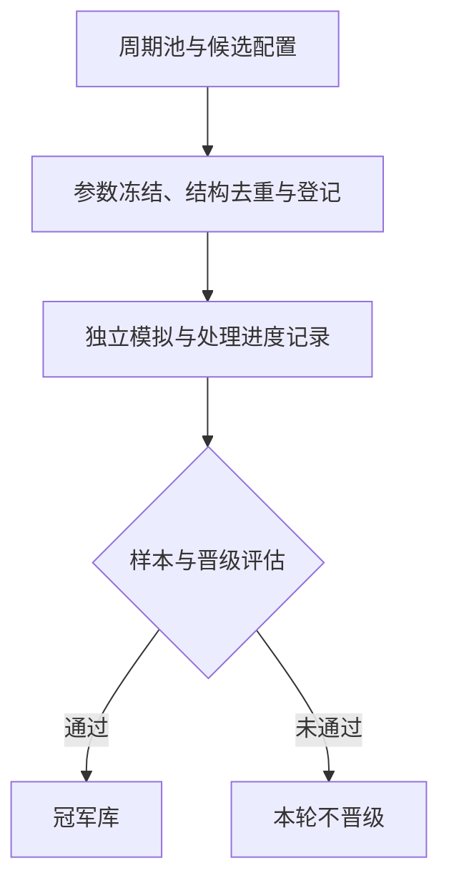
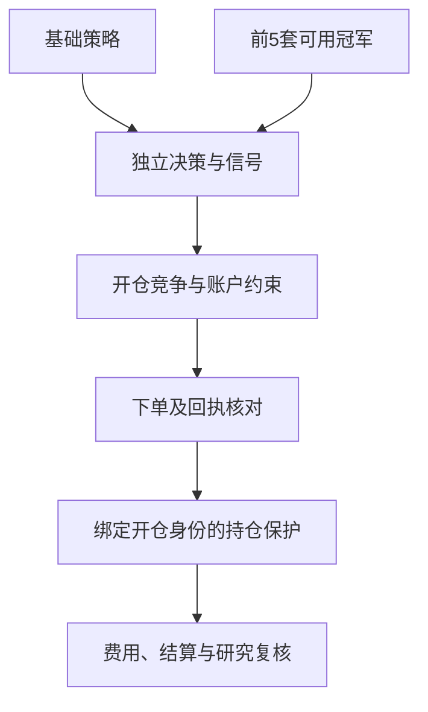

# 架构与组件职责

展示重点是“周期池 → 生成策略 → 模拟运行 → 合格评估 → 冠军库 → 并行交易竞争”。这是一张概括职责的示意图，不是生产系统的完整拓扑、调用顺序或接口文档。

## 研究与晋级



## 入选与执行



## 过程中的具体设计

| 过程 | 公开说明 |
| --- | --- |
| 候选登记 | 记录固定配置、身份和起始处理位置，便于核验结果的来源 |
| 独立模拟 | 使用共享市场输入，分别维护各策略的决策、信号及交易记录 |
| 变体与重试 | 规则变体重新评估；同一数据任务重试保留原策略身份 |
| 晋级 | 评估有效样本、盈利条件和多空成交覆盖；具体门槛不公开 |
| 并行竞争 | 基础策略独立参与，前5套可用冠军提供额外候选机会 |
| 持仓责任 | 入选资格变化后，已有持仓对应的保护责任继续保留 |
| 执行复核 | 用实际成交和账单核对结果，供后续研究复盘 |

## 可公开说明的边界

| 组件 | 对外说明 |
| --- | --- |
| 周期池 | 提供可用于策略研究的周期范围；不提供真实池配置与选取规则 |
| 候选策略生成 | 形成可评估的策略；不提供构造公式、搜索空间及参数分布 |
| 并行模拟 | 为候选策略积累运行记录；不提供生产评估实现和内部记录 |
| 合格评估 | 根据预设要求判断能否晋级；不公布实际门槛及评估细节 |
| 冠军库 | 保存通过评估的策略，选择参与实际竞争的策略；不提供排名公式及当前策略配置 |
| 并行交易竞争 | 基础策略与入选冠军策略独立产生机会，交由账户层协调；不提供信号计算及竞争细则 |
| 订单及持仓管理 | 处理执行结果和持仓保护；不提供实盘连接、退出条件及管理参数 |
| 记录与复核 | 辅助检查研究和实际运行结果；只提供虚拟演示记录 |

## 必须区分的两件事

策略并行运行，是多个策略分别进行计算和提供机会。账户能否下单，是独立的执行约束。前者不能绕过后者。

模拟合格表示满足设定的筛选要求，不等于证明策略在今后的所有市场状态下都有效。冠军库也不是盈利保证。

## 演示程序对应关系

`demo.py` 只实现一个教学用的内存模拟器：

```text
固定虚拟事件 → 信号数据结构 → 模拟账户约束 → 审计事件列表
```

信号已经写在虚拟场景里。程序不会从价格计算信号，也没有真实决策组件的适配器。示例接口为展示重新设计，不能据此推断生产接口字段或调用时序。

候选策略生成、合格评估与实际交易决策的内部组件不发布可调用服务、模型文件、二进制包或查询地址。
